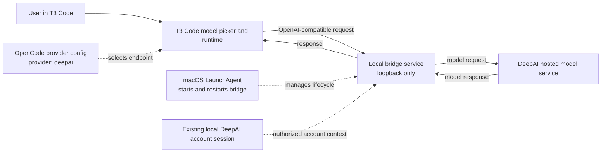

# DeepAI models in T3 Code

A short architecture note about a personal setup that made DeepAI Code-hosted models available from T3 Code, including while the DeepAI Code desktop app was closed.

> **Unofficial and experimental.** This is a description of one local setup, not a supported integration or an endorsement by DeepAI, T3 Code, or OpenCode. The bridge implementation and credentials are intentionally **not** included in this repository. Provider APIs, account terms, and desktop-app behavior can change; check the applicable terms before attempting a similar setup.

## What we built

T3 Code can use OpenAI-compatible model endpoints. DeepAI Code's desktop app normally makes its hosted models available through a local gateway while the app is running. We added a small, separate local relay in between:

1. A standalone bridge listens only on the Mac's loopback interface.
2. T3 Code has a custom `deepai` provider configured to use that bridge.
3. The bridge forwards model requests to DeepAI using the user's existing, authorized account session.
4. A macOS LaunchAgent starts and restarts the bridge in the background.

Because the relay is separate from the desktop app process, the app does not need to remain open for requests to work. The bridge still depends on the local account session being valid and on the upstream service continuing to accept the integration.

## Architecture

## What appears in the picker

The models are registered under a custom provider ID, for example `deepai/glm-5.3-flash`. In the T3 Code picker, custom providers configured through OpenCode appear within the **OpenCode** section. That section identifies the configuration source; it is not a separate provider-company category. A custom provider can therefore be usable and searchable without receiving its own left-rail icon or section.

## Security and privacy

- The bridge should bind to loopback only; it is not intended to be exposed to a LAN or the public internet.
- Keep local credentials and bridge authorization tokens private. Never commit them, paste them into issues, or include them in screenshots.
- Use restrictive permissions for credential and configuration files, and rotate credentials if they may have been exposed.
- The bridge uses the local account session. Anyone who can access that session or the local service may be able to make requests as that account.
- Review the bridge implementation and the provider's current terms yourself. This repository deliberately contains no credential-handling code or undocumented authentication details.

## Limitations

- This is an unofficial personal integration and may stop working if either application or the upstream service changes.
- Closing the DeepAI Code app is different from removing it: the local account session may still be required by the bridge.
- The model list, names, availability, and usage limits can change. Only configure models you are authorized to use.
- A local relay adds another process to maintain and troubleshoot; it is not a hosted service.

## Scope of this repository

This public repository documents the architecture and lessons learned. It does **not** contain the bridge, private account data, tokens, machine identifiers, or setup scripts. That separation is intentional: the original bridge was tailored to one machine and depends on local credentials and an undocumented upstream interface.
